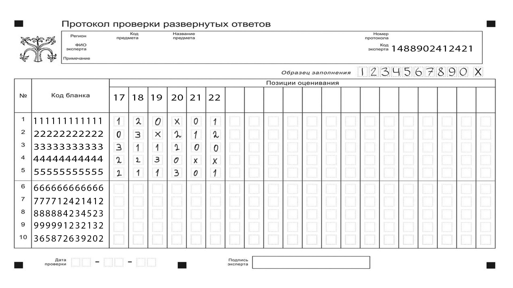

# RateScaner — обработка протоколов оценивания

Python-прототип для чтения протоколов проверки развёрнутых ответов: распознаёт идентификаторы работ и экспертов, оценки двух экспертов, отмечает расхождения и экспортирует результаты в SQLite и Excel.

Это обработка таблиц оценок, а не распознавание текста ответов учеников. Бланки и результаты в репозитории созданы автором для разработки.

## Посмотреть результат без установки

**[Бланки, результат OCR и проверенный Excel →](docs/demo.md)**



Два бланка → распознавание → ручная проверка → сравнение оценок → SQLite и Excel.
В [демонстрации](docs/demo.md) сохранены исходный OCR-снимок с тремя ошибками в 60 оценках,
ручная расшифровка и [Excel после проверки](examples/protocol_demo/results.xlsx).
Пары оценок с расхождениями подсвечены в Excel. Это небольшой демонстрационный набор,
а не оценка общей точности модели.

## Быстрый запуск без OCR

Проверенный JSON-пример позволяет проверить сравнение и экспорт без весов и Tesseract. Нужен Python 3.12:

```bash
python3.12 -m venv .venv
source .venv/bin/activate
python -m pip install openpyxl
python main.py --from-json examples/recognized_pages.json --output outputs/example-01
```

На Windows активация окружения: `.venv\Scripts\activate`.

Появятся `outputs/example-01/results.xlsx`, `results.sqlite3` (таблица `results`) и копия входных данных `recognized_pages.json`. Каталог результата должен быть новым: существующие результаты не перезаписываются. Пример содержит две работы; у первой отмечены расхождения в позициях 2 и 4.

## Распознавание изображений

1. Установите зависимости: `python -m pip install -r requirements.txt`.
2. Установите системный Tesseract и английский языковой пакет. Ubuntu: `sudo apt-get install tesseract-ocr tesseract-ocr-eng`; macOS: `brew install tesseract`.
3. Возьмите доверенные веса [best_conv_net_model_X.pth](https://github.com/place3/CNNModel_nums_X/blob/main/Pytorch_models/best_conv_net_model_X.pth) из [репозитория обучения](https://github.com/place3/CNNModel_nums_X) и положите в `models/`. Каталог исключён из Git. Например, если репозитории лежат рядом:

```bash
mkdir -p models
cp ../CNNModel_nums_X/Pytorch_models/best_conv_net_model_X.pth models/
```

Положите в отдельный каталог только нужные изображения. Смешанный каталог `scans/` содержит разные экспериментальные материалы и не является готовым входным набором.

```bash
python main.py --input /path/to/protocols --output outputs/scan-01 \
  --model models/best_conv_net_model_X.pth \
  --rois data/ROIs.json --work-count 5
```

`--work-count` — число первых строк бланка для чтения (1–10, по умолчанию 6). Пример выше читает пять работ. На каждую работу нужны страницы от двух разных экспертов. Нельзя добавлять повторную копию той же страницы для получения пары.

Если Tesseract отсутствует в PATH, передайте `--tesseract /path/to/tesseract`. Полный список параметров: `python main.py --help`. Пути по умолчанию вычисляются относительно проекта; текущий рабочий каталог может быть другим.

## Исправить OCR без повторного распознавания

После чтения всех изображений программа сохраняет `recognized_pages.json` в каталоге результата.
Сверьте идентификаторы и оценки с бланками, скопируйте JSON и исправьте ошибки в копии:

```bash
cp outputs/scan-01/recognized_pages.json corrected_pages.json
# Исправьте значения в corrected_pages.json в текстовом редакторе
python main.py --from-json corrected_pages.json --output outputs/scan-01-reviewed
```

Повторный запуск не загружает модель и не обращается к Tesseract. Исходный результат
остаётся без изменений; копию исправленного JSON сохраняет новый каталог.

Если все страницы прочитаны, но данные не прошли проверку (например, пустой ID,
отсутствует второй эксперт), программа завершится с ошибкой, сохранив JSON и
`review_required.txt`. SQLite/Excel в этом случае не создаются. Исправьте JSON или
добавьте действительно недостающие данные и повторите `--from-json` с новым каталогом.
Ошибки до завершения чтения изображений (нет весов, повреждённый файл, неверный ROI)
не гарантируют сохранение частичного распознавания.

## Формат проверенных данных

```json
[
  {"expert_id": "001", "works": {"000001": [1, 2, 0, "X", 0, 1]}},
  {"expert_id": "002", "works": {"000001": [1, 4, 1, 0, 0, 1]}}
]
```

Идентификаторы задаются строками из цифр. Оценки — 0–4 или X, по шесть на работу. Разница чисел от двух баллов и несовпадение X отмечаются как расхождения. JSON-сценарий предназначен для уже проверенных данных и сам изображения не распознаёт.

## Структура и статус

| Часть | Назначение |
| --- | --- |
| `main.py`, `scaner_service.py` | Консольный запуск |
| `CORE/scan_docs.py` | Области изображения, Tesseract и CNN |
| `CNNModel/model.py` | Архитектура сети и явная загрузка весов |
| `scanner_pipeline.py` | Проверка двух оцениваний, сравнение, SQLite и Excel |
| `data/ROIs.json` | Координаты полей конкретного шаблона |
| `examples/` | Демонстрационные проверенные данные |
| `GUI/` | Незавершённый desktop-интерфейс; отдельно от активного CLI |

[Архитектура, исторический код и ограничения](docs/architecture.md). Обучение находится в [CNNModel_nums_X](https://github.com/place3/CNNModel_nums_X); начатый веб-интерфейс — в [web_rate_scaner](https://github.com/place3/web_rate_scaner).

## Проверки

```bash
python -m pip install -r requirements.txt
python -m unittest discover -s tests -v
```

Тесты проверяют сравнение оценок, неполные/повторные проверки, сохранение ведущих нулей, содержимое SQLite/Excel, запрет перезаписи результата, CLI из другого каталога, границы ROI и отказ при отсутствии весов. Для них не нужны веса, запущенный GUI или системный Tesseract. GitHub Actions запускает их на Python 3.12 / Ubuntu с CPU-версией PyTorch.

**Ограничения:** OCR рассчитано на фиксированную разметку; точность на независимом наборе протоколов здесь не подтверждена. Распознанные данные требуют ручной проверки. Новый CLI не завершает старый GUI и не подключает FastAPI-оболочку. Старый позиционный запуск `scaner_service.py input output` заменён явными параметрами, показанными выше.

[Результаты локальной проверки и известные ошибки OCR](docs/verification.md).
