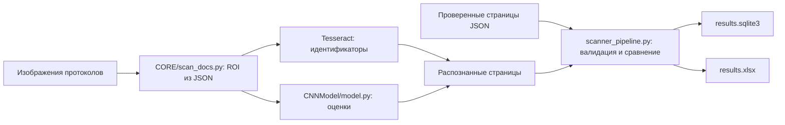

# Устройство и границы проекта

## Активный консольный сценарий

`main.py` вызывает CLI из `scaner_service.py`. В JSON-сценарии OCR-библиотеки и веса
не загружаются. В OCR-сценарии модель загружается один раз, работает на CPU и требует
доверенный checkpoint. В отсутствие весов программа завершается ошибкой, а не
использует случайно инициализированную сеть.

Оценки: `0`, `1`, `2`, `3`, `4`, `X`. На каждую работу ожидаются ровно два разных
эксперта с шестью оценками. Несовпадение `X` с другим значением или разница чисел
не менее двух отмечается как расхождение. Это правило сравнения, а не автоматическое
определение правильной итоговой оценки. Эксперты сортируются по строковому ID для
стабильного порядка колонок; E1/E2 не отражают время загрузки или приоритет эксперта.

Пустые/нечисловые идентификаторы, повтор одного эксперта, третья проверка и неполные
оценки отклоняются. Программа не угадывает отсутствующие данные. Идентификаторы
остаются строками, чтобы сохранить ведущие нули.

## Экспорт

Результаты сначала создаются во временном каталоге рядом с целевым. После создания
SQLite, Excel и recognized_pages.json публикуется новый каталог. Существующий каталог результата не
переиспользуется. Репозиторные демонстрационные БД не читаются и не изменяются.
В SQLite создаётся таблица `results`; её схема отличается от старых экспериментальных
таблиц. Автоматической миграции прежних БД нет.

Если распознавание всех страниц завершилось, но проверка структуры данных не прошла,
публикуются только JSON и review_required.txt, а CLI возвращает ошибку. Это позволяет
исправить результат и повторить --from-json, не распознавая изображения заново.
Копия JSON сохраняется и при успешном экспорте из --from-json; наличие файла не означает
автоматической проверки правильности OCR. Сохранение частичных данных при ошибке
чтения изображения или ROI до завершения распознавания не реализовано.

В Excel подсвечиваются именно пары оценок с расхождением по правилу сравнения.
Подсветка не определяет, какая оценка верна, и не обозначает уверенность модели.

## Связанные репозитории

- [CNNModel_nums_X](https://github.com/place3/CNNModel_nums_X): обучение и веса сети.
- [web_rate_scaner](https://github.com/place3/web_rate_scaner): отдельная начатая
  FastAPI-оболочка. В текущем состоянии реальное OCR туда не подключено.

## Исторический код

Старый незавершённый GUI, экспериментальные реализации CNN и БД, вырезанные символы,
промежуточные результаты и графические исходники убраны из текущего дерева. Они не
импортируются активным CLI. Версия до очистки сохранена отдельным тегом, а более
ранние варианты — в истории Git. [Состав архива и просмотр старых файлов](history.md).

Архив содержит прежние локальные пути и операции перезаписи данных. Это история
разработки, а не инструкция запуска актуальной версии.

## Ограничения OCR

Координаты из `data/ROIs.json` предназначены для конкретного шаблона изображения.
Другой размер, поворот, перспектива или расположение полей требуют подготовки
изображения и/или другого JSON. Автовыравнивания и распознавания произвольных бланков
нет. `--work-count` задаёт количество первых строк бланка для чтения.

Наличие checkpoint и корректный формат результата не гарантируют правильность
распознавания. Поля и оценки необходимо проверять вручную. Здесь нет измеренной
точности на независимом наборе протоколов и порога отказа по уверенности модели.
Сценарий `--from-json` проверяет сравнение/экспорт, но не качество OCR.
